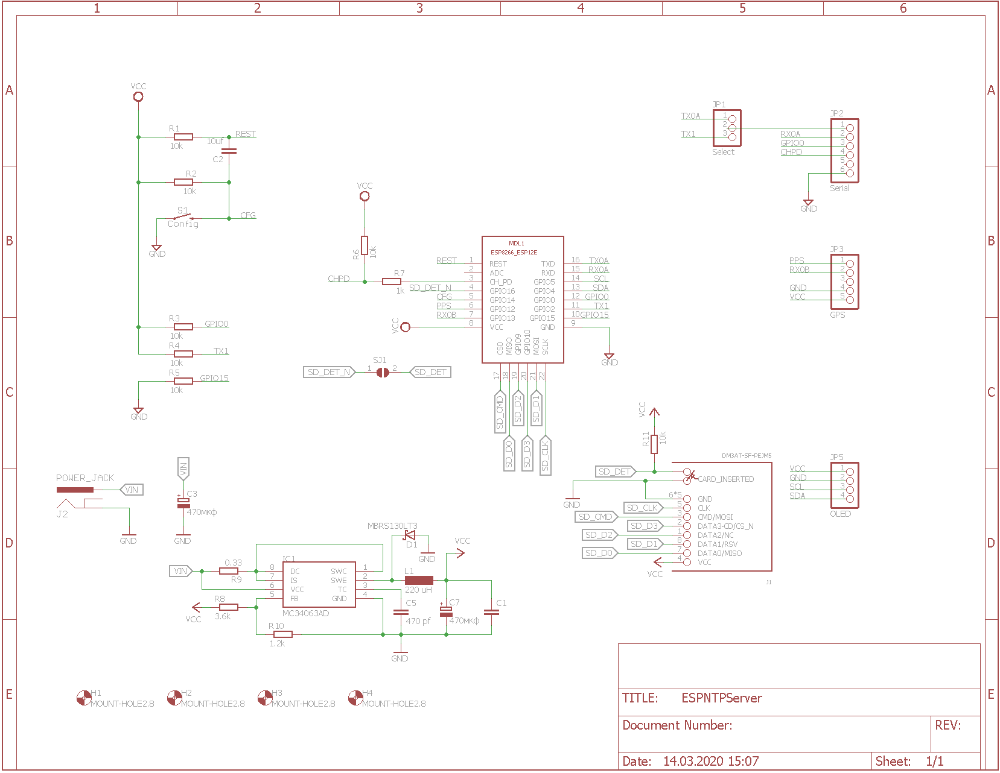
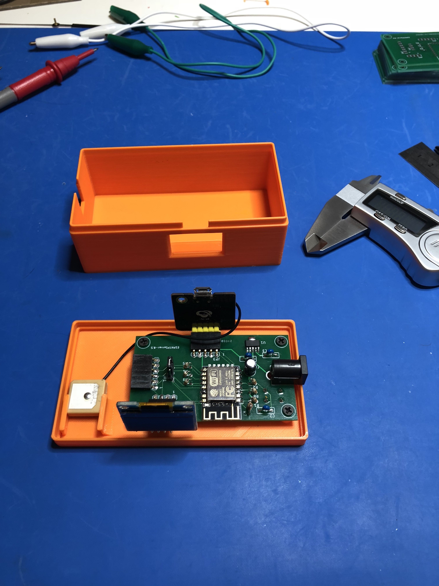
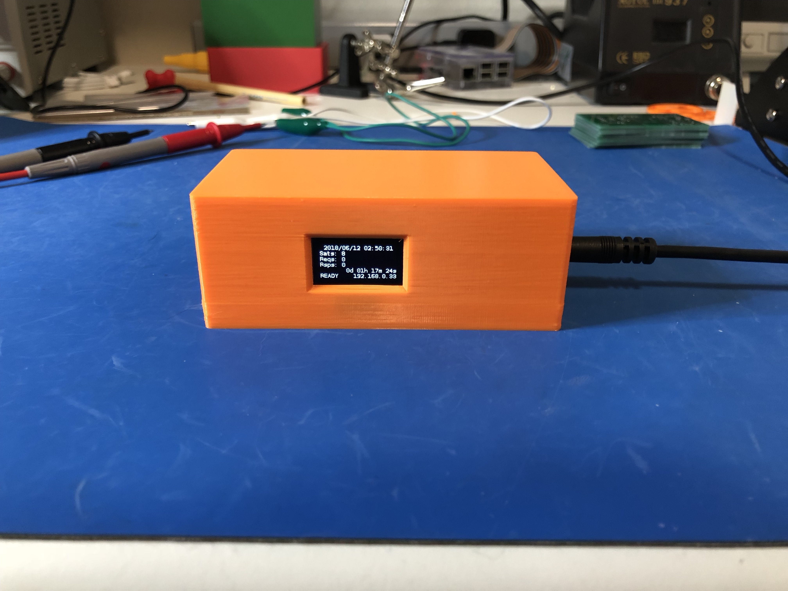

# ESPNTPServer

GPS-synchronized ESP8266 time server with legacy time protocols and NMEA output.

The deployed debug build is `1.3.5-debug`. See [the protocol reference](docs/PROTOCOLS.md)
for wire formats, availability rules, discovery, management routes, and tests.

## Features

| Interface | Transport | Purpose |
| --- | --- | --- |
| NTP v3/v4 | UDP 123 | GPS/PPS-synchronized stratum-1 time |
| RFC 867 Daytime | TCP and UDP 13 | Human-readable UTC time |
| RFC 868 Time | TCP and UDP 37 | Four-byte 1900-epoch time |
| NMEA 0183 | TCP 10110 | GGA/RMC stream for local clients |
| NMEA 0183 | UDP 10110 | GGA/RMC directed-subnet broadcast |
| mDNS/DNS-SD | UDP 5353 | Discover HTTP and NMEA services |
| Management | HTTP on TCP 80 | Diagnostics and controlled OTA reboot |
| Receiver control, debug only | HTTP on TCP 80 | Bidirectional UBX request/response |

The device also reads NMEA/UBX from the receiver over UART and PPS on GPIO12,
downloads firmware from its configured HTTP(S) OTA server at boot, and can send
optional UDP syslog to a configured host. These are not additional public
time-service listeners. The temporary Wi-Fi configuration portal is separate
from the normal management API. Details are in the [protocol reference](docs/PROTOCOLS.md).

All time protocols use the GPS time source for high accuracy. They remain
silent until GPS time and PPS have been continuously valid for 60 seconds
after startup or a PPS interruption. Network NMEA is not subject to this
time-service delay.

The GPS PPS signal on GPIO12/D6 is captured by a minimal IRAM interrupt
handler. NTP uses the raw lwIP UDP API so receive and transmit timestamps are
placed as close as the ESP8266 software stack permits to packet processing.
The ESP8266 Wi-Fi hardware does not provide MAC-level packet timestamps, so
radio scheduling and retransmissions can still add millisecond-scale jitter.
The NTP root-dispersion value therefore has a conservative five-millisecond
software-timestamp uncertainty floor. This describes server-side uncertainty;
clients still measure and filter their own network round-trip delay.

## Network NMEA

The server publishes an `ESPNTP NMEA` DNS-SD service with `accuracy=exact` and
streams CRLF-terminated NMEA 0183 GGA and RMC sentences to persistent TCP
clients on the IANA-assigned port 10110. It also sends each sentence as one UDP
datagram to the directed broadcast address of the local subnet on port 10110
and advertises `ESPNTP NMEA Broadcast` as `_nmea-0183._udp.local`. Only
sentences with a valid NMEA checksum and a usable position fix are forwarded.
The TCP service and management interface accept clients only from the device's
local IP subnet; the UDP datagrams remain confined to that subnet by broadcast
routing rules.

NMEA transmission and mDNS processing run in the latter half of each PPS
second, keeping this background traffic away from the PPS edge and the most
latency-sensitive NTP receive/transmit window. UDP uses the asynchronous lwIP
path: the firmware only copies a small datagram into the network stack and
never waits for a receiver or acknowledgement. The fixed queue and two-client
TCP limit bound RAM use and disconnect persistently slow TCP clients.

OpenCPN, AvNav, gpsd, Signal K/OpenPlotter and many marine navigation apps can
receive NMEA 0183 over UDP. Configure a UDP input on port 10110; no sender IP is
needed for broadcast reception. TCP remains preferable when delivery and order
must be guaranteed. Plain NMEA 0183 multicast is deliberately not enabled:
there is no universally assigned multicast group and it is less widely
supported than broadcast. IEC 61162-450 and NMEA OneNet multicast are different
protocols and are not advertised by this firmware.

## HTTP diagnostics and OTA

The management interface listens on TCP port 80 and only accepts requests from
the device's local IP subnet.

- `GET /diagnostics.txt` returns plain-text `key=value` runtime diagnostics,
  including PPS age, PPS timeout count, GPS validity count, and protocol
  request/response counters. It also reports the NTP timestamp mode,
  advertised timestamp uncertainty, and latest/maximum response-processing
  times.
- In the temporary debug build, diagnostics also show the latest receiver
  `MON-HW` interference state, its age, CW indicator, noise, AGC, and antenna
  supervisor status. The receiver pushes `MON-HW` over UART1 every 10 seconds;
  an HTTP request does not poll the receiver. State `unknown` is not equivalent
  to `ok`.
- The experimental debug build also caches sparse `NAV-PVT`, `NAV-DOP`,
  `NAV-SVINFO`, and `MON-IO` messages. Diagnostics show fix validity/type,
  satellites used, time/horizontal accuracy, DOP, GPS signal/ephemeris/C/N0
  aggregates, and UART1 error counters. `MON-HW` additionally supplies event
  transition counts, last-event time, and a minute-bucket maximum `jamInd` over
  the last hour. These are receiver estimates and counters, not NTP network
  timestamp accuracy; absent or stale messages must not be treated as healthy.
- `POST /ota` schedules a reboot and therefore an immediate OTA check during
  startup. The request must contain `X-OTA-Confirm: reboot`; the custom header
  also prevents a normal cross-origin browser form from triggering a reboot.
- The temporary `1.3.5-debug` build exposes `POST /debug/ubx` and
  `GET /debug/ubx` for arbitrary checked UBX frames and matching responses.
  It has no password or HTTPS and is restricted only to the device's local
  subnet. Do not use this image on an untrusted network.

Examples:

```sh
curl 'http://<device-ip>/diagnostics.txt'
curl -X POST -H 'X-OTA-Confirm: reboot' 'http://<device-ip>/ota'
```

Replace `<device-ip>` with the unit's address on your local subnet.

OTA runs before the GPS PPS interrupt is enabled, including after a remotely
requested reboot.

## CI/CD

GitLab CI validates and builds commits unless CI is explicitly skipped (for
example, with `[skip ci]`). Pipelines on the default branch (`master`)
additionally publish `firmware.bin` to the configured OTA directory. The
deployment target, verification route, host key, and firmware defaults are
provided by protected CI variables, not stored in this repository. Deployment
verifies the image size, MD5, and SHA-256 before
publication, preserves the previous image, replaces the active file atomically,
and downloads it through the real OTA endpoint as a final end-to-end check. A
failed final check restores the previous firmware.

## Contents

[src](src) Contains the code for the NTP Server

[eagle](eagle) contains the schematic and board designs in Eagle cad.

[enclosure](enclosure) contains the STL files for the enclosure.

This is designed around [this GPS module](https://www.amazon.com/gp/product/B075DD5746/) but any module with standard NMEA output and a pult per second signal will work if you redesign the board or use an adapter.

I also used [this display module](https://www.amazon.com/gp/product/B00O2KDQBE/).  You can use others but be careful with the power polarity, I have modules where VCC and ground pins are in a different order.




